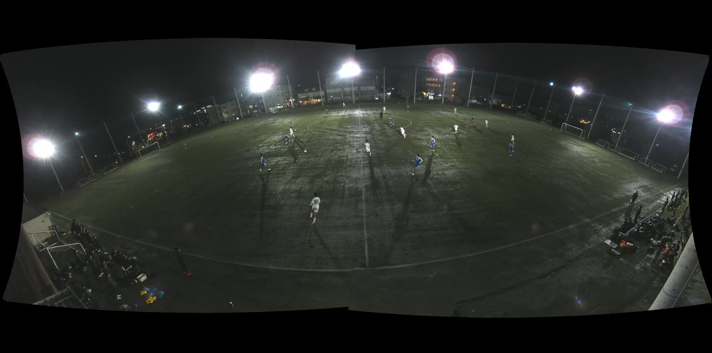
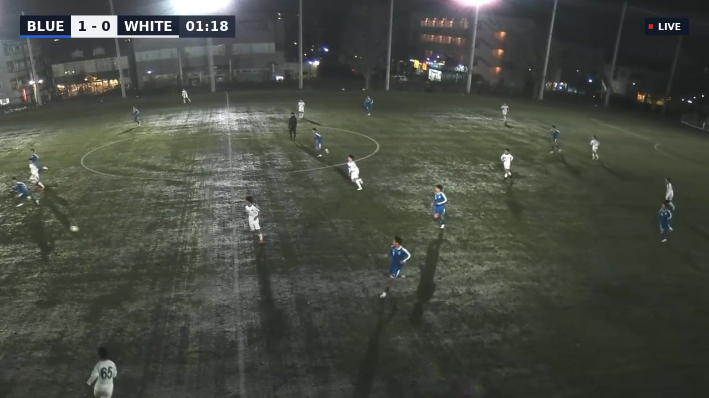
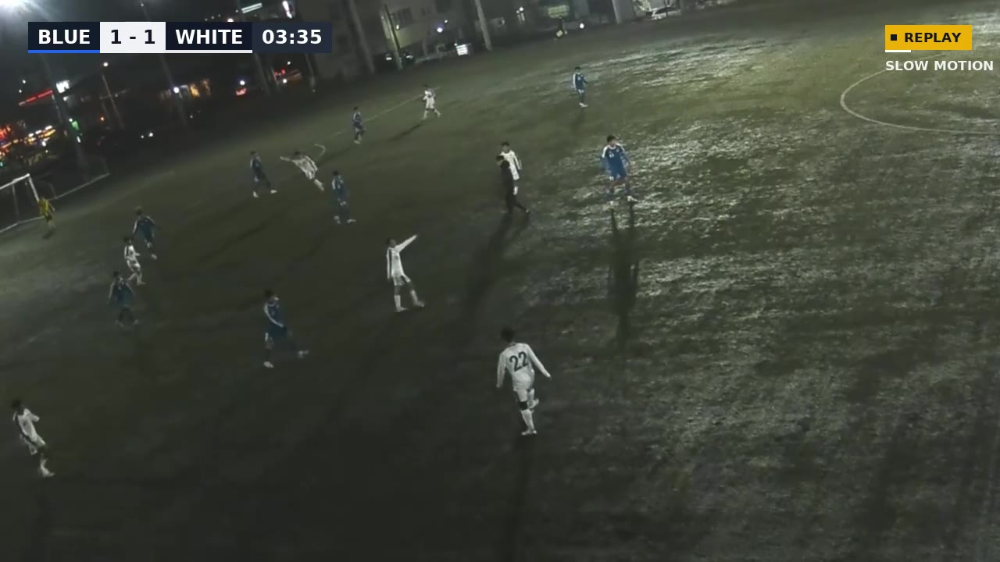
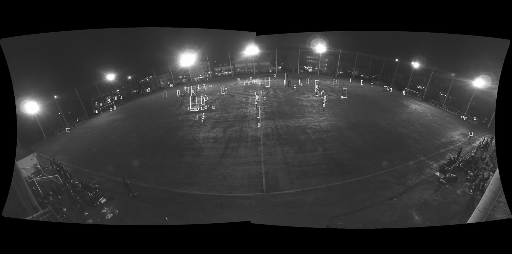

# Match Director

Turns **one fixed wide-angle camera** at a football match into a **produced broadcast**, automatically:

- **Auto-director:** detects and tracks players and drives a smooth 16:9 virtual camera that follows the play inside a 4K panorama.
- **GPU graphics engine:** scoreboard, match clock, animated lower thirds, and a LIVE/REPLAY bug, rendered with OpenGL ES 3 from a FreeType glyph atlas in a single draw call per frame.
- **Instant replay:** a rolling buffer of *compressed* packets. A goal or an operator command re-decodes the moment and inserts it in slow motion with a tighter camera, and also exports it as a clip.
- **Operator control:** a REST API plus a small web panel (goal, replay, captions, team names, kick-off), or a timed events file.
- **Output:** H.264 (x264) with the original audio passed through, to a file, `rtmp://` or `srt://`.

Written in C++20. Linux (developed on WSL2 Ubuntu 24.04).

> **Status:** works end to end on a real 45-minute night match recording, measured on 5-minute sections. It is a prototype: the detector is classical computer vision (see *Limitations*), and nothing has been tested yet with a live camera or a real RTMP/SRT server.

## Before → after

**Before:** the raw input, one fixed 3840×1906 stitched panorama (night match, 25 fps).



**After:** the same moment, as Match Director's 1280×720 program output. The virtual camera has found and framed the play, and the scoreboard, clock and LIVE bug are rendered on the GPU.



**Instant replay:** re-decoded from the packet buffer, half speed, a tighter camera, with the REPLAY/SLOW MOTION bug. The score reflects a *demo* goal event.



**What the detector sees:** boxes on the half-resolution analysis frame. The players are found; a few floodlight-shadow fragments still pass (see *Limitations*).



## Pipeline

```
 decode thread           analysis thread          compositor thread (GPU)        encoder thread
 ─────────────           ───────────────          ───────────────────────        ──────────────
 demux + H.264 decode ─► background subtraction ─► upload crop window ─► YUV→RGB ─► x264 encode
 packet ring (replay)    Kalman + Hungarian         scoreboard/captions (1 draw)    mux + audio copy
 replay re-decode        virtual camera director    RGB→NV12 on GPU, readback       replay clip export
 timeline + commands                                                                stats / camera log
        ▲                                                  ▲
        └──── HTTP control thread (REST + web panel) ──────┘ (commands are frame-accurate)
```

Threads are connected by bounded lock-free SPSC queues ([`Channel`](include/md/core/channel.hpp)) that carry frame *handles* from preallocated pools. There is no per-frame `new`, and queues are bounded, so a slow stage applies back-pressure. Details: [docs/architecture.md](docs/architecture.md).

## Results (measured)

Test input: a 3840×1906 25 fps stitched panorama of a night match (H.264, ~20 Mb/s). Machine: Intel i7-13700H (20 threads), 16 GB, **Intel Iris Xe (no NVIDIA GPU)**, WSL2 Ubuntu 24.04, GCC 13.3, Release build. Output 1280×720.

**5-minute run** (source 600–900 s, 3 demo replays; [stats](docs/results/run_5min_stats.json)):

| Metric | Result |
|---|---|
| Processing speed (file mode) | **73 fps = 2.9× real time** for 4K input |
| GPU compositor per frame | p50 4.8 ms, p95 12.8 ms |
| Analysis (detect + track + direct) per frame | p50 11.0 ms, p95 19.0 ms |
| Peak memory (RSS) | 1.97 GB |
| Replays rendered / clips exported | 3 / 3 (201 source frames each, ½ speed) |
| Encoder buffer reuse conflicts | 0 |
| Audio | 12,920 AAC packets passed through |

**Live mode** (`--realtime`, input paced at 25 fps, 40–60 s runs; latency = packet read → frame handed to the muxer):

| Decode threads | Latency p50 / p95 / p99 | Late frames |
|---|---|---|
| auto (~20) | 666 / 707 / 1213 ms | 58 in 60 s |
| 8 | 345 / 353 / 362 ms | 0 |
| **4 (default for `--realtime`)** | **185 / 195 / 204 ms** | **0** |

FFmpeg's frame threading delays output by about one frame per thread, which is why latency scales with thread count. See [LESSONS.md](LESSONS.md).

**Compositor A/B** (30 s, file mode):

| Variant | Compositor p50 / p95 | Note |
|---|---|---|
| default (crop-window upload, async PBO readback) | 4.47 / 12.66 ms | |
| full-frame upload | 7.88 / 16.70 ms | uploading only the crop saves ~43% at p50 |
| synchronous readback | 4.26 / 11.15 ms | **no gain from async PBO on this driver**, kept as an option |
| software GL (llvmpipe) | 5.65 / 22.92 ms | total throughput falls to 52 fps (it competes for CPU) |

**Building blocks** ([bench/results](bench/results/)): SPSC queue 53 M items/s between two threads, 245 ns p50 hand-off; crop maths 22 ns/frame.

**Director (no ground truth yet; these are proxies):** pan speed mean 58 px/s, p95 160 px/s (source pixels). 75% of tracked objects fall inside the virtual camera. Mean tracked objects is 42.6 while there are ~23 people on the pitch, so roughly half the tracks are still shadows or noise (see *Limitations*).

## Build and run

```bash
bash scripts/install_deps_ubuntu.sh                       # once (Ubuntu 24.04 / WSL2)
cmake --preset release && cmake --build --preset release
bash scripts/run_match.sh assets/match.mp4 600 300 ~/md_out/demo   # 5 min from 10:00
```

Live operator panel: add `--realtime --http 8080` and open `http://127.0.0.1:8080/`.

```bash
curl -X POST localhost:8080/api/command -d '{"type":"goal","team":"home","text":"No. 9"}'
curl -X POST localhost:8080/api/command -d '{"type":"replay","seconds":8}'
```

Tests (51) under sanitizers:

```bash
cmake --preset debug-asan && cmake --build --preset debug-asan && ctest --preset debug-asan
cmake --preset debug-tsan && cmake --build --preset debug-tsan && setarch x86_64 -R ctest --preset debug-tsan
```

Useful flags: `--gpu d3d12|llvmpipe`, `--full-upload`, `--sync-readback`, `--decode-threads N`, `--camera-log cam.csv`, `--debug-dir d` (detector masks), `--output rtmp://…`.

## Limitations (honest)

- **Detection is background subtraction.** It suits a fixed camera and needs no GPU, but floodlight **shadows** and turf glare still create false tracks (≈42 tracks vs ≈23 people). The camera still frames the play well because false tracks cluster around real players. The next step is a small ONNX person detector run on tiles. The `Detection` struct is the seam for it.
- **No ball tracking.** At this resolution the ball is only a few pixels and often invisible at night, so the director follows player density and movement.
- **Director quality is measured only by proxies.** There's no labelled ground truth for this match. A labelled set (or SoccerTrack) is needed for "action-in-frame" accuracy.
- Replays pause the live feed (like a broadcast on a delay); there's no picture-in-picture.
- RTMP/SRT output uses FFmpeg's muxers but **has not been tested against a server**.
- Single camera: no multi-camera switcher.
- The scoreboard events in the demo are **made up for the demo** ("DEMO EVENT"); they are not the real score of this match.
- 3-hour soak test: not done yet.

## Docs

[Architecture](docs/architecture.md) · [Decisions](docs/decisions.md) · [Lessons / bugs found](LESSONS.md) · [Dataset status](docs/dataset_status.md) · Notes: [SPSC queue](docs/notes/spsc_queue.md), [detector](docs/notes/detector.md), [tracker & director](docs/notes/director.md), [GPU compositor](docs/notes/compositor.md), [replay](docs/notes/replay.md)
